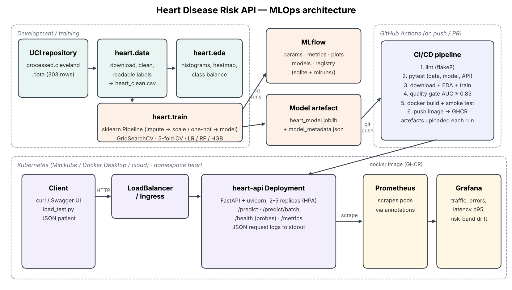

# Heart Disease Risk API — End-to-end MLOps

[](https://github.com/2025ae05835/heart-mlops/actions/workflows/ci.yml)

MLOps (AIMLCZG523) Assignment 1 · **VIPIN VK** · BITS ID 2025ae05835

- Report: [`docs/MLOps_Assignment1_Report.docx`](docs/MLOps_Assignment1_Report.docx) ([PDF](docs/MLOps_Assignment1_Report.pdf))
- Video walkthrough: [`video/2025ae05835.mp4`](video/2025ae05835.mp4)
- Deployed API: local Kubernetes (Minikube), not public. Access instructions in [section 5](#5-kubernetes-minikube).

Predicts the risk of heart disease from 13 clinical measurements (UCI Heart Disease, Cleveland subset) and serves it as a containerised, monitored REST API on Kubernetes.



| Stage | Tooling | Where |
|---|---|---|
| Data download + cleaning | Python, pandas | `src/heart/data.py`, `scripts/download_data.sh` |
| EDA | matplotlib, seaborn | `src/heart/eda.py`, `notebooks/01_eda.ipynb`, `reports/figures/` |
| Features + models | scikit-learn Pipeline, GridSearchCV | `src/heart/features.py`, `src/heart/train.py` |
| Experiment tracking | MLflow (sqlite backend + model registry) | `mlflow.db`, `mlruns/` (created on train) |
| Packaging | joblib pipeline + MLflow model | `models/` |
| Tests | pytest (18 tests) | `test/` |
| CI/CD | GitHub Actions | `.github/workflows/ci.yml` |
| Serving | FastAPI + uvicorn in Docker | `api/`, `Dockerfile` |
| Deployment | Kubernetes manifests (Deployment, LoadBalancer, Ingress, HPA) | `k8s/` |
| Monitoring | JSON request logs, Prometheus, Grafana | `api/main.py`, `monitoring/`, `k8s/monitoring/` |

## 1. Setup (clean environment)

Requires Python 3.11+ (3.12 recommended), Docker, and for deployment Minikube or Docker Desktop Kubernetes.

```bash
git clone https://github.com/2025ae05835/heart-mlops.git && cd heart-mlops
python -m venv .venv && source .venv/bin/activate      # Windows: .venv\Scripts\activate
pip install -r requirements.txt
export PYTHONPATH=src:.                                # Windows PowerShell: $env:PYTHONPATH="src;."
```

## 2. Run the pipeline

```bash
python -m heart.data --force    # download from UCI -> data/raw, clean -> data/processed/heart_clean.csv
python -m heart.eda             # figures -> reports/figures/
python -m heart.train           # tunes LR / RF / HGB, logs to MLflow, saves models/heart_model.joblib
mlflow ui --backend-store-uri sqlite:///mlflow.db --port 5000   # http://localhost:5000
flake8 src api test && pytest -v
```

(`make all` runs install → data → eda → train → lint → test → docker-build.)

**Data source.** `heart.data` downloads the official UCI file `processed.cleveland.data`. If UCI is unreachable it falls back to a GitHub mirror of the same 303 patients and converts the mirror's re-encoded columns back to the UCI codes (mapping covered by a unit test).

## 3. Serve locally

```bash
uvicorn api.main:app --port 8000                       # Swagger UI: http://localhost:8000/docs
curl -X POST localhost:8000/predict -H "Content-Type: application/json" -d @sample/patient.json
```

Response:

```json
{"prediction": 1, "label": "heart_disease", "probability_disease": 0.9938,
 "confidence": 0.9938, "risk_band": "high", "model_name": "logistic_regression",
 "request_id": "3ff073d7f3f5"}
```

Endpoints: `GET /health`, `POST /predict`, `POST /predict/batch`, `GET /metrics`. Inputs are validated (ranges and allowed category values); invalid requests return HTTP 422. `ca` and `thal` are optional and imputed.

## 4. Docker

```bash
docker build -t heart-api:latest .
docker run --rm -p 8000:8000 heart-api:latest
curl -X POST localhost:8000/predict -H "Content-Type: application/json" -d @sample/patient.json
```

Local monitoring stack (API + Prometheus + Grafana):

```bash
docker compose up --build
python scripts/load_test.py --url http://localhost:8000 --n 300
# Grafana http://localhost:3000 (admin/admin) -> dashboard "Heart API - Service & Model Monitoring"
```

## 5. Kubernetes (Minikube)

```bash
minikube start --cpus 4 --memory 6g
bash scripts/deploy_k8s.sh          # builds image inside minikube, applies k8s/ + monitoring
minikube tunnel                     # separate terminal: gives the LoadBalancer an external IP
kubectl -n heart get svc heart-api  # EXTERNAL-IP
curl -X POST http://<EXTERNAL-IP>/predict -H "Content-Type: application/json" -d @sample/patient.json
kubectl -n heart port-forward svc/grafana 3000:3000
```

Docker Desktop: enable Kubernetes, then `TARGET=docker-desktop bash scripts/deploy_k8s.sh`; the LoadBalancer is on `http://localhost`.
Ingress (optional): `minikube addons enable ingress && kubectl apply -f k8s/ingress.yaml`, map `heart.local` to `minikube ip`.

## 6. CI/CD

`.github/workflows/ci.yml` runs on every push/PR: **lint → test → train (+ AUC ≥ 0.85 quality gate) → docker build + container smoke test → push image to GHCR** (main only). Each job uploads artifacts (JUnit results, model, reports, MLflow db, container logs). Any lint error, failing test, or quality-gate miss fails the run.

## 7. Results (current run)

| Model | CV ROC-AUC | CV accuracy | Hold-out ROC-AUC | Hold-out accuracy | Hold-out recall |
|---|---|---|---|---|---|
| **Logistic Regression (selected)** | **0.907 ± 0.019** | **0.855** | **0.961** | 0.869 | 0.929 |
| Random Forest | 0.902 ± 0.021 | 0.814 | 0.955 | 0.885 | 0.929 |
| Hist Gradient Boosting | 0.894 ± 0.025 | 0.834 | 0.948 | 0.885 | 0.893 |

Selection uses mean 5-fold CV ROC-AUC on the training split; the 61-patient hold-out is reported only. The chosen configuration (C = 0.3, L2, class_weight = balanced) is then refit on all 303 rows. Full table: `reports/model_comparison.csv`.

## 8. Verified environment

| Component | Version |
|---|---|
| Lab VM | Rocky Linux 9.5, 4 vCPU, 15 GB RAM |
| Python | 3.12 (conda) |
| Docker | 28.0.1 |
| Kubernetes | Minikube 1.35 (docker driver), Kubernetes 1.32, kubectl 1.32 |
| CI | GitHub Actions, ubuntu-latest, Python 3.12 |

## 9. Evidence (screenshots)

All screenshots are in [`screenshots/`](screenshots/).

| What | Screenshot |
|---|---|
| MLflow runs, compare view, artifacts | `01_mlflow_experiments.png`, `02_mlflow_compare.png`, `03_mlflow_artifacts.png` |
| Lint + 18 unit tests passing | `04_pytest_local.png` |
| CI/CD run (all green) and its artifacts | `05_github_actions_run.png`, `06_github_actions_artifacts.png` |
| CI blocking a pull request with a lint error | `05b_pipeline_fails.png` |
| Docker container test | `07_docker_build_run.png` |
| Kubernetes pods/services and LoadBalancer prediction | `08_k8s_pods_svc.png`, `09_k8s_predict.png` |
| Swagger UI | `10_swagger_ui.png` |
| Grafana dashboard, Prometheus targets, JSON logs | `11_grafana_dashboard.png`, `12_prometheus_targets.png`, `13_api_logs.png` |

## Repository layout

```
api/            FastAPI app + pydantic schemas
src/heart/      config, data, eda, features, train, predict
test/           pytest unit tests
notebooks/      01_eda.ipynb, 02_inference.ipynb
data/           raw/ and processed/ (cleaned CSV)
models/         heart_model.joblib, model_metadata.json
reports/        figures/, model_comparison.csv, eda_summary.json
k8s/            deployment.yaml, ingress.yaml, monitoring/
monitoring/     prometheus.yml, Grafana provisioning + dashboard
scripts/        download_data.sh, deploy_k8s.sh, load_test.py
screenshots/    screenshots used in the report
docs/           architecture diagram, report
```
